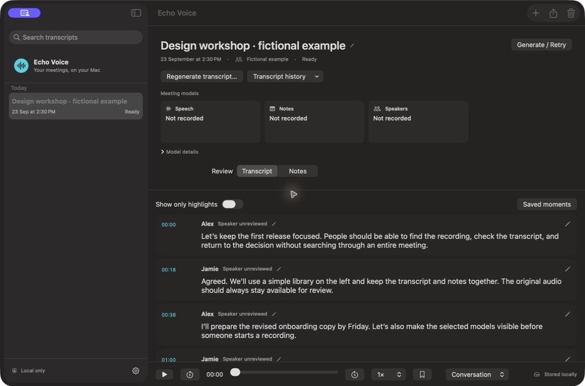

# Echo Voice

A local meeting workspace for Apple Silicon Macs. Record an online call or a conversation in the room, turn speech into an editable transcript, and return to the words behind your notes.

**Release status:** 1.0 is under qualification. The direct download and Mac App Store listing will be available after their respective release checks.

[Preview the standalone landing page](website/echo-voice.html).

## What it does

- **Online meetings:** capture the selected application and microphone separately. Browser capture can include other audible tabs in that browser.
- **In-person conversations:** record one room microphone. Optional speaker grouping adds labels after recording; it does not produce isolated voice recordings.
- **Your models, in view:** speech, notes and speaker-grouping choices appear in the workspace. Choose native models or a compatible, locally installed Ollama model for notes.
- **Review with the audio:** word-following replay, timestamps, speed controls, saved highlights and bookmarks. Approximate timing is identified.
- **Make corrections:** edit text, rename generic speakers, add a vocabulary dictionary, search and regenerate transcripts while retaining history.
- **Keep useful notes:** summaries, decisions and action items link to transcript evidence. Review generated text before relying on it.
- **Keep control:** export notes, transcripts and labelled audio. Delete app-managed meetings whenever you choose; independent exports remain.
- **Control a recording:** choose live transcription before starting, stop it for the rest of a meeting, mute Echo Voice's microphone, and change selected inputs without deliberately ending the recording.
- **Review and manage long meetings:** browse paged transcripts, hear speaker samples while naming speakers, and delete a passage's interval across managed audio and transcript history. Completed audio can be stored losslessly compressed.

No meeting bot, account, analytics or hosted inference service. Recording continues when a local inference worker fails. Screen capture and visual context are not features of this release.

## Requirements and installation

Apple Silicon; macOS 14.2 or later is the deployment target. Validation on the minimum version and the complete supported-hardware matrix remains pending. Model memory and disk needs vary; Models settings shows per-model sizes. Recording checks free storage using actual device formats and an eight-hour estimate.

Production builds include the speech runtimes. They do not require Xcode, Homebrew, system Python, or package installation on the user's Mac. Model weights are separate, explicit downloads; some speaker models require accepting their access conditions.

The planned distribution channels are a free, signed and notarized direct download and a free Mac App Store app after approval. Until release qualification is complete, locally signed candidates are for local verification. Do not disable Gatekeeper to distribute them as production builds.

## Website release

The public download is a GitHub Release asset named `Echo-Voice-<version>-arm64.dmg`. The landing page does not store the binary. `website/release.json` turns the download button on only when `direct.available` is true, the asset URL matches that release, and a SHA-256 checksum is present. `scripts/build-website.py` writes `website/echo-voice.html`. Privacy and support pages are `website/privacy.html` and `website/support.html`. The support address there is a placeholder and must be replaced before publication. The App Store button stays off until a live listing exists. Choose the site host and set `canonical` before publishing the pages.

## First meeting

1. Follow the **Setup Guide** that opens on first launch. It checks the included runtime, downloads the speech model you choose with a progress bar, offers optional notes and speaker grouping, and shows microphone access. Every step can be skipped; reopen it from **Help → Setup Guide…** or the status indicator at the bottom of the sidebar, which reads **Ready to record**, **Setup required**, **Downloading** or **Microphone access needed**.
2. Downloads continue in the background while you browse. Recording waits until a download finishes or is cancelled; the New Meeting button explains why. Manage models later in **Settings → Models**.
3. For Ollama notes, start your own local Ollama server, choose **Meeting notes → Run using → Ollama**, refresh, choose a model, and select **Use as Default**. Echo Voice neither installs nor removes Ollama models.
4. Choose **New Meeting → Online meeting** or **In person**. Select the inputs, choose whether to show live transcription, and acknowledge recording consent. Input testing is optional.
5. Start, pause or stop from the app or menu bar. You can stop live transcription during the meeting, but cannot restart it until a new meeting. After recording stops, review the complete transcript and notes. Missing model setup queues processing without discarding saved audio.
6. Use **Export** for an independent copy. Keep Echo Voice open while recording and processing.

Read the [user guide](docs/USER_GUIDE.md), [recovery and backup guide](docs/OPERATIONS.md), [privacy policy](docs/PRIVACY.md).

## Build and contribute

See [CONTRIBUTING.md](CONTRIBUTING.md) for source builds, focused tests and the code layout. Private audio fixtures and detailed benchmark outputs are excluded from this repository.

Source repository: https://github.com/samarthmn/echo-voice

Report reproducible problems through the repository's issue templates. Do not attach private recordings, transcripts, model-access tokens, or complete application-data folders.

## License

Echo Voice's original code is [MIT licensed](LICENSE). Dependencies, bundled runtimes and downloaded models retain their own licenses and access terms. See [third-party notices](docs/THIRD_PARTY.md); a complete redistribution audit is a release gate.
